<p align="center">
  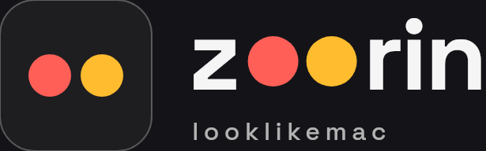
</p>

# Zorin OS, with a macOS feel

A GNOME Shell extension for **Zorin OS 18 (GNOME 46, Wayland)**. It adds a living notch, a full
menu bar or glass islands with system info, a glass dock, and calendar and weather widgets on the
desktop, with one Preferences window to control all of it.

It draws its own UI but leaves the system work to GNOME: Wi-Fi, Bluetooth, volume, brightness,
power off, notifications and calendars all go through GNOME's own components, so nothing here
talks to NetworkManager, logind or the audio server directly.

[](https://github.com/soefyan45/zoorinlooklikemac/releases)


[](LICENSE)

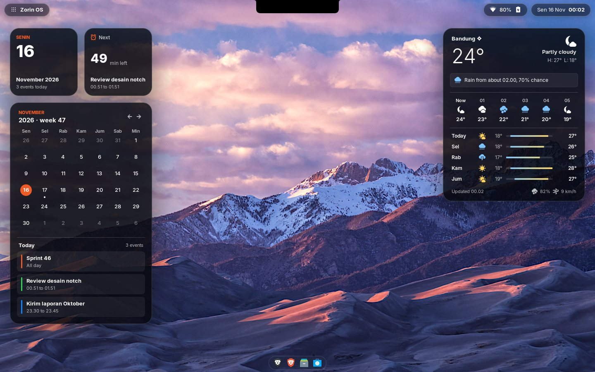

<sub>The extension in a nested GNOME Shell: glass islands, the notch block, the full calendar and
weather widgets, and the dock.</sub>

## Contents

- [Features](#features)
- [Install](#install)
- [Fan boost and CPU limits](#fan-boost-and-cpu-limits-optional)
- [Undo](#undo)
- [Design](#design)
- [Development](#development)
- [Notes](#notes)

## Features

### 01 · A living notch

At rest the notch is a thin line (or a liquid lens). It grows as the pointer comes near, shows
date, time, network and battery on hover, and a click opens the full panel. Notifications, music,
coding agents, Wi-Fi and the power menu all appear right inside it. Springs instead of fixed-time
animations.

- **Full panel**: Wi-Fi, Bluetooth, dark mode and do-not-disturb tiles, volume and brightness
  sliders, tray icons of running apps, Apps, search, notifications, settings, lock and power.
- **Notifications**: GNOME's banners pop out of the notch, with GNOME's own filters. An orange
  dot marks unread ones; swipe right to dismiss.
- **Spotlight search**: press Super and type. Apps, plus files and text inside documents through
  GNOME's Tracker index (with the `zorin-notchd` daemon).
- **Power menu**: lock, suspend, log out, restart and power off through GNOME's SystemActions,
  with GNOME's confirmation dialog.
- **Coding agents**: Claude Code and opencode report to the notch: a working animation on the
  line, a popup when they need permission or finish, and Allow / Deny right on the notch.
- **Music**: an equalizer on the line while something plays; hover for the title and controls.

| Hover | Agent at work | Agent needs you | Notification | Search |
|---|---|---|---|---|
| 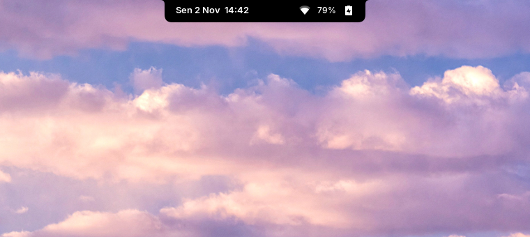 | 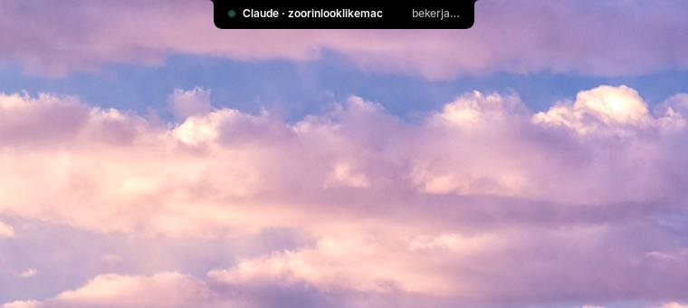 | 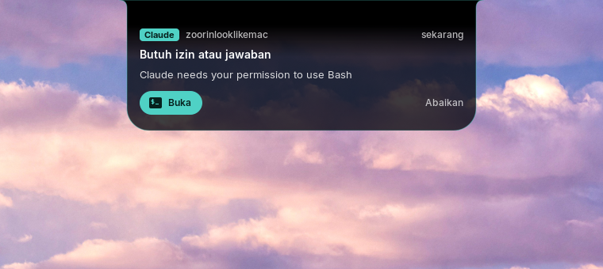 | 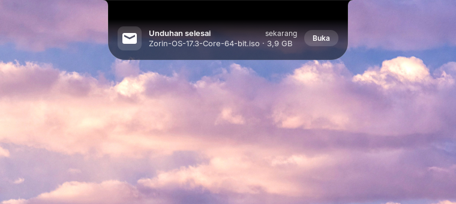 | 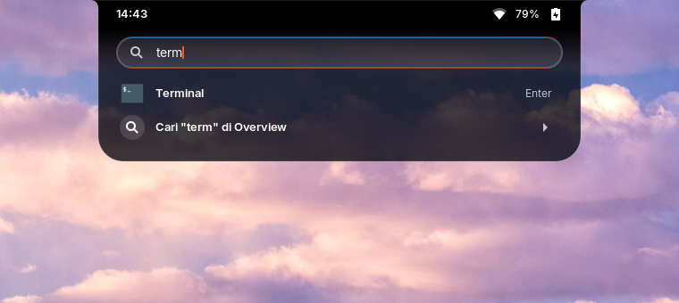 |

### 02 · Glass dock

zorin-taskbar turned into a floating, centered dock with a slim glass plate, dots for open apps,
icon magnification under the pointer and optional auto hide.

### 03 · Four top bar modes, with a glass you can tune

What shows at the top while the notch rests:

| | Mode | |
|---|---|---|
| A | **Thin line** | the cleanest; status on hover |
| B | **Status notch** | clock and battery always beside the notch |
| C | **Full menu bar** (default) | like macOS: app and Activities on the left, status, date and time on the right |
| D | **Glass islands** | the same content in separate glass islands, the wallpaper shows between them |

**System info** shows in every mode: CPU load with a mini chart, CPU temperature with a colored
dot, and optionally GPU, memory, SSD temperature and network speed. A click opens the detail
panel (dark, glass or accent glass) with the busiest apps and the power profile buttons. The
temperature warning notifies once, can repeat after a set time, or be switched off.

**Menu bar glass** (Preferences > Menu bar): glass style (clear, frost, dark, or tinted from the
wallpaper), tint color, transparency, background blur and the bottom line, with a live preview on
your own wallpaper. The bar can turn solid while a window is maximized, stay solid always, and
switch to dark text on light glass.

| System panel | Preferences > Menu bar |
|---|---|
| 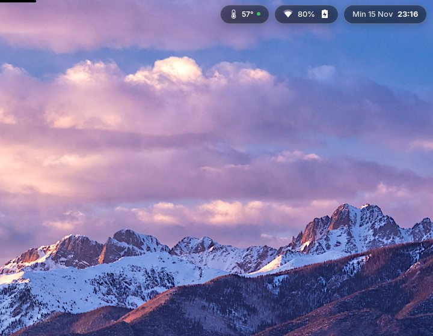 | 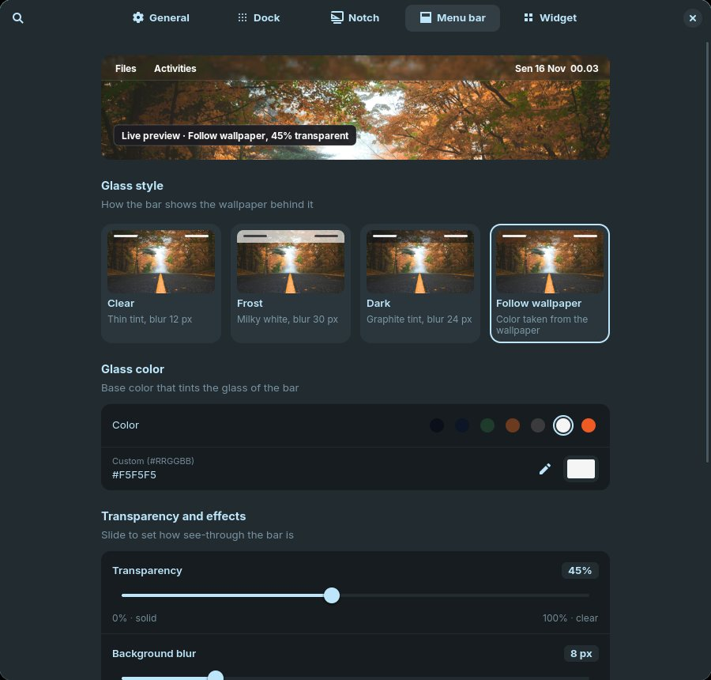 |

### 04 · Calendar and weather widgets

A calendar on the left and the weather on the right of the desktop, under the windows. Pick their
styles in Preferences > Widget or with a right click on a widget; either can be hidden, or both
shown above the windows.

**Calendar, 7 styles**: full (month, agenda and two small tiles), agenda blocks, week arc, glass
month, today's meetings, black and white, tear-off. Events come from GNOME's calendar server, the
same as the clock's menu: local calendars and online accounts such as Google.

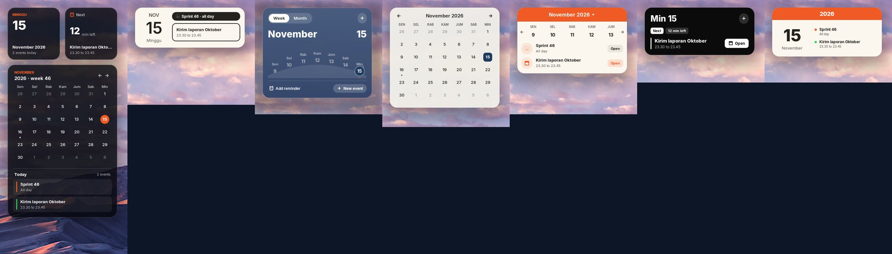

**Weather, 4 styles**: full (hourly, 5 days, rain warning), sun arc, big temperature, date strip.
From [Open-Meteo](https://open-meteo.com): free, no account; only the coordinates are sent, every
15 minutes while a weather widget is shown. The place is the device's location when GNOME's
location services are on, else the city typed in Preferences > Widget.

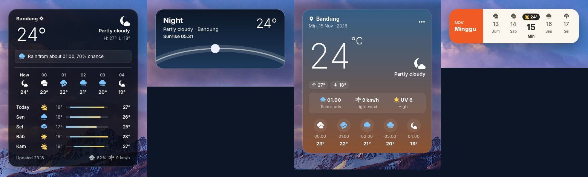

### 05 · Two displays

Preferences > General > Show the notch on: the primary display, one display by name, the display
with the mouse pointer (the notch moves there when it rests), or all displays. When the notch
follows the pointer with the full menu bar, every display keeps its bar, so maximized windows do
not jump; the bar of the display without the notch is dimmed, as on macOS.

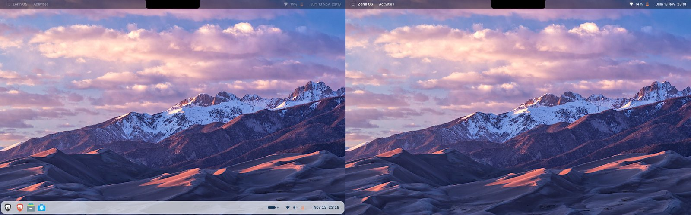

### 06 · Preferences

One window with five tabs, every change live:

- **General**: language (English, Bahasa Indonesia), theme (dark, light, follow system), accent
  color, which display shows the notch.
- **Dock**: auto hide, size, icon spacing, glass padding, distance from the bottom, zoom, glass
  opacity.
- **Notch**: top bar mode, status on hover, system info, detail panel style and chart color, fan
  boost, power profile and CPU limits, behavior, notch style (classic or liquid), floating notch.
- **Menu bar**: the glass of the bar.
- **Widget**: widget styles, temperature unit, location, above or under the windows.

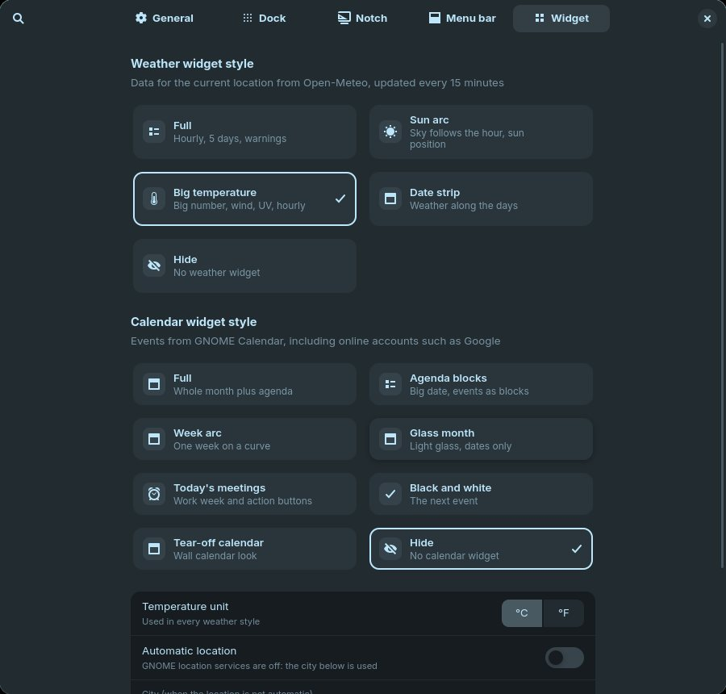

## Install

Requirements:

- Zorin OS 18 (GNOME Shell 46) on Wayland
- `zorin-taskbar` (preinstalled on Zorin OS) for the dock
- `jq` and `gdbus` for the agent hooks
- From source: Rust (cargo) for the `zorin-notchd` daemon
- No sudo and no system files, except the optional fan boost service

### From a release (no build tools)

Download `zoorinlooklikemac-<version>-linux-x86_64.tar.gz` from
[Releases](https://github.com/soefyan45/zoorinlooklikemac/releases) (built by GitHub Actions on
Ubuntu 24.04, the base of Zorin OS 18), then:

```bash
tar xzf zoorinlooklikemac-*-linux-x86_64.tar.gz
cd zoorinlooklikemac-*-linux-x86_64
./install.sh                 # extension + zorin-notchd daemon (makes a backup first)
./install.sh --dock --agents # optional: also the dock preset and the agent hooks
./install.sh --remove        # take it out again
```

Then log out and back in.

### From source

```bash
git clone https://github.com/soefyan45/zoorinlooklikemac.git
cd zoorinlooklikemac
./scripts/install.sh              # copies the extension and enables it (makes a backup first)
./scripts/install-daemon.sh       # the zorin-notchd daemon (system info, file search, permissions)
./scripts/apply-dock.sh           # optional: zorin-taskbar as the dock
./scripts/install-agent-hooks.sh  # optional: Claude Code hooks + opencode plugin
```

Then log out and back in (on Wayland GNOME Shell loads new extensions at login).

## Fan boost and CPU limits (optional)

Some ASUS laptops (e.g. Zenbook 14) let the fan run only on the firmware's auto curve or at full
speed. `zoorin-fan-boost` is a small root service that turns it to full speed while the CPU is hot
and back to auto when it cools down (default: full from 75 °C, auto below 68 °C, at least 60 s at
full speed). It is off after installing: turn it on and set both temperatures in
Preferences > Notch > Fan. They are written to `/etc/zoorin-fan-boost/fan.conf` (owned by you) and
the service picks them up within seconds.

```bash
sudo ./scripts/install-fan-boost.sh            # install (or update) and start
sudo ./scripts/install-fan-boost.sh --remove   # remove, fan back to auto
```

The same service holds the CPU limits from Preferences > Notch > Power: the highest CPU
performance in percent (intel_pstate `max_perf_pct`), Turbo Boost on or off, and the energy
preference (EPP; "follow the power profile" leaves it alone). The defaults change nothing, and
everything goes back to normal when the service stops. The power profile itself (power saver,
balanced, performance) needs no service.

## Undo

```bash
./scripts/rollback.sh backups/<backup made before install>.dconf
./scripts/install-agent-hooks.sh --remove
rm -r ~/.local/share/gnome-shell/extensions/zoorinlooklikemac@soefyan45.github.io
```

`scripts/backup.sh` saves `/org/gnome/shell/` before every change, and `rollback.sh` restores
it (saving the current state first).

## Design

Designed in Pego (project `zoorinlooklikemac`): the base desktop and notch states, the top bar
options, the liquid notch, the desktop widgets and their style galleries, the Preferences tabs,
and a design system of reusable components.

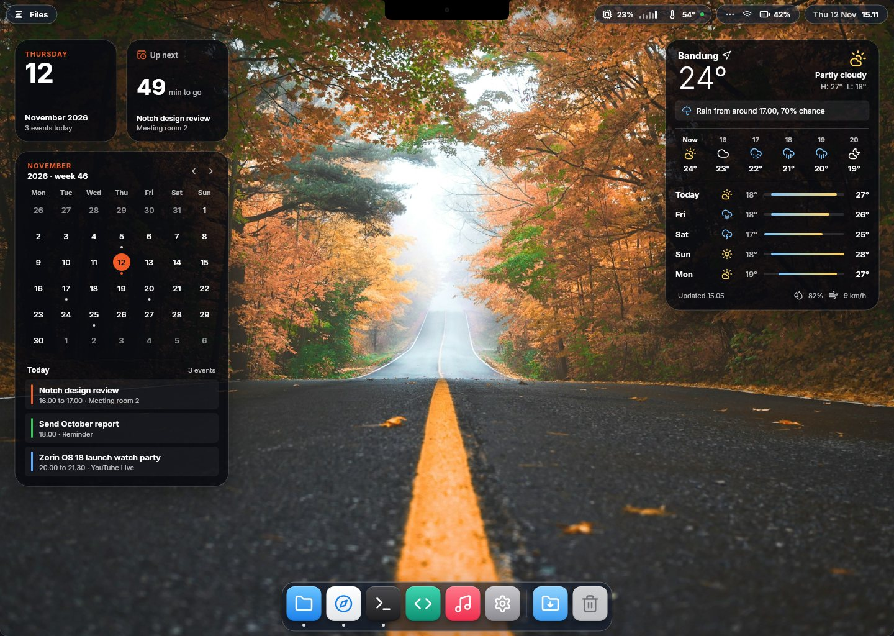

| All notch states | Notification | Dock magnification |
|---|---|---|
| 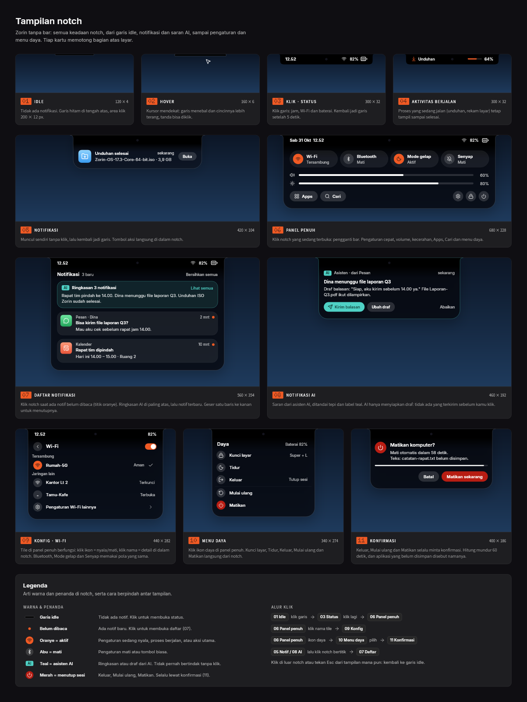 | 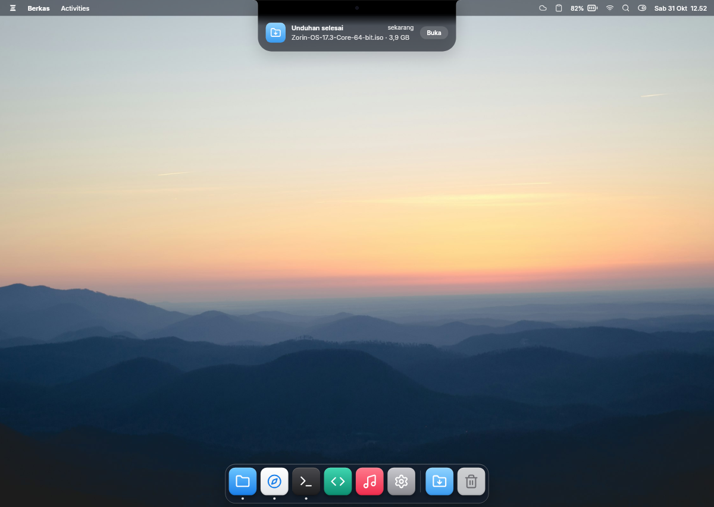 | 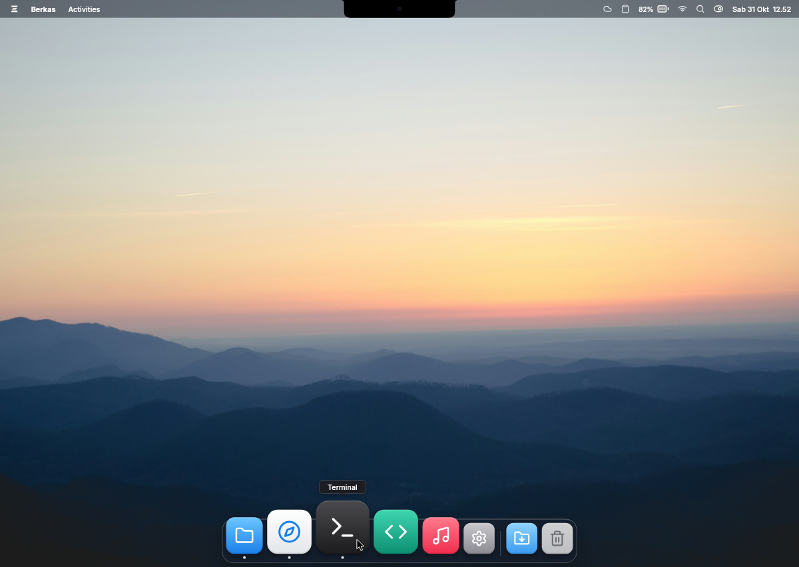 |

## Development

Test without logging out, in a nested GNOME Shell with its own settings database:

```bash
./scripts/nested-test.sh                       # 1440×900 window, power actions only log
SELFTEST=1 DOCK=1 ./scripts/nested-test.sh     # automated checks + screenshots in logs/shots
SELFTEST=1 MONITORS=2 ./scripts/nested-test.sh # two displays
SELFTEST=widgets ./scripts/nested-test.sh      # only the desktop widgets
NOTIFY=1 TRACE=1 ./scripts/nested-test.sh      # a real notify-send, with state tracing
./scripts/prefs-check.sh "$PWD/extension"      # build the Preferences window and list its rows
```

The nested session uses sample calendar events and sample weather, and never touches the real fan
config. In a normal session, create `~/.cache/zorin-notch/trace` to turn on tracing in the
journal:

```bash
journalctl --user -f | grep zorin-notch
```

| Path | What |
|---|---|
| `extension/` | the GNOME Shell extension: `notch.js` state machine, `views.js` UI, `shape.js` Cairo drawing, `topbar.js` and `barlook.js` the bar and its glass, `systempanel.js`/`sysinfo.js` system info, `widgets*.js`/`weather.js` desktop widgets, `prefs.js` Preferences, bridges to GNOME (`quicksettings.js`, `power.js`, `messages.js`, `tray.js`, `agents.js`) |
| `daemon/` | `zorin-notchd` (Rust): file search, system stats, permission prompts |
| `fan/` | the `zoorin-fan-boost` root service |
| `agents/` | Claude Code hook and opencode plugin |
| `dock/` | zorin-taskbar dock preset |
| `scripts/` | install, backup, rollback, nested test |
| `docs/` | product requirements and plan (Indonesian), design and implementation images |

## Notes

- Uses private fields of GNOME Shell 46 (quick settings items); each access is guarded, and a
  missing one only hides that control. Check again after a GNOME upgrade.
- The design shows Lucide icons; the extension uses GNOME's symbolic icons.
- GNOME's calendar server gives no event locations, so the widgets show times only.
- Wallpaper in the design images: photo by Patrick Tomasso, Unsplash.

## License

[MIT](LICENSE)
