# zoorinlooklikemac — Zorin Notch

A macOS-style desktop for **Zorin OS 18 (GNOME 46, Wayland)**: the top bar is gone, a
**notch** at the top center holds the clock, status, quick settings, notifications, power
menu and coding-agent activity, and a floating **dock** sits at the bottom.

It is a GNOME Shell extension that draws its own UI but leaves the system work to GNOME:
Wi-Fi, Bluetooth, volume, brightness, power off and notifications all go through GNOME's own
components, so nothing here talks to NetworkManager, logind or the audio server directly.

## Design

Designed in Pego (project `zoorinlooklikemac`).

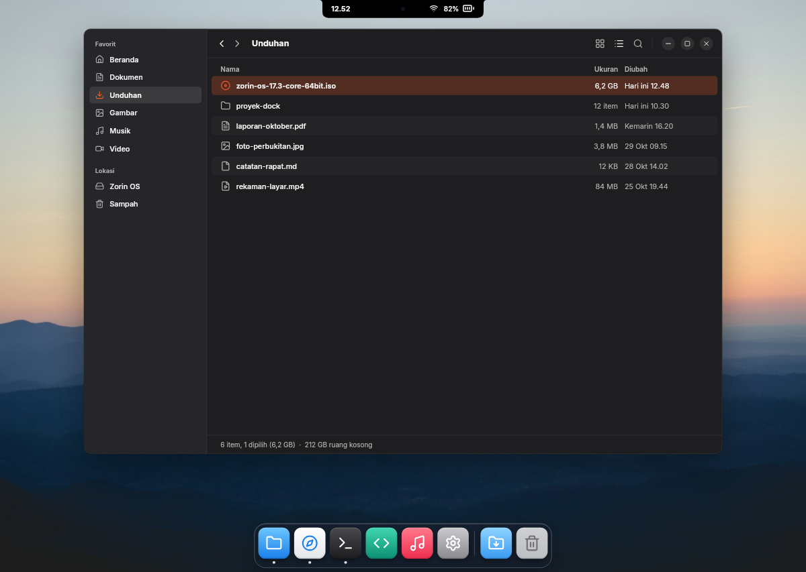

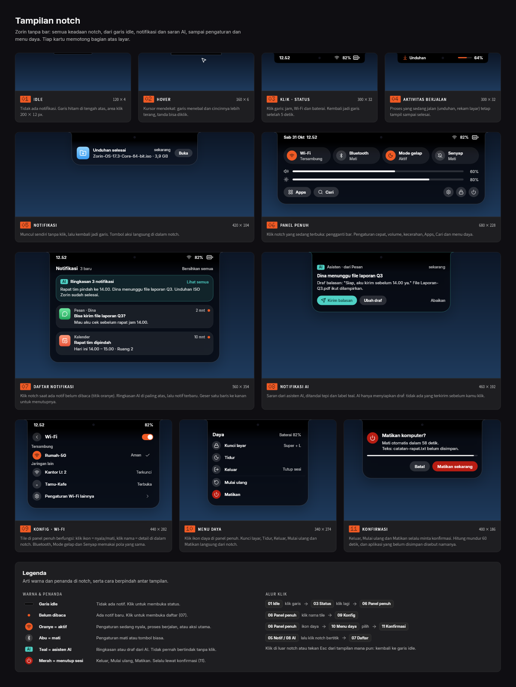

| Notification | Tools panel | Dock magnification |
|---|---|---|
| 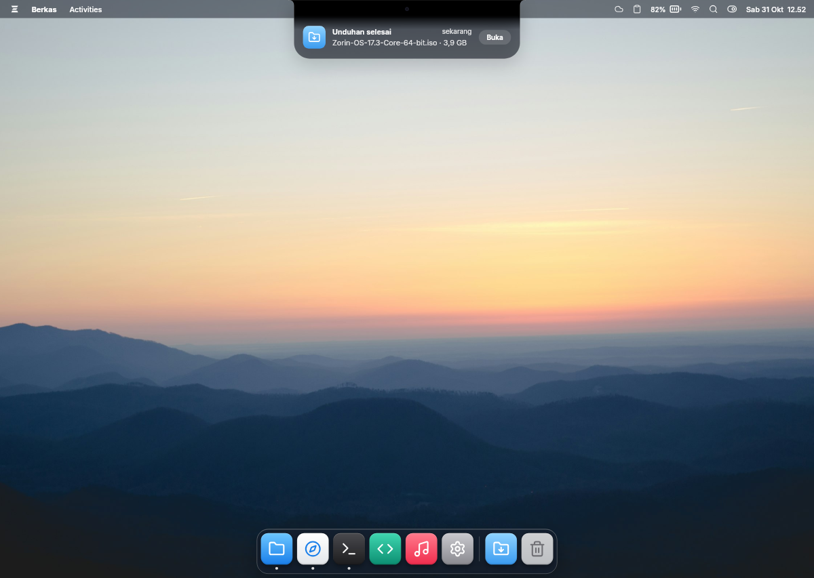 | 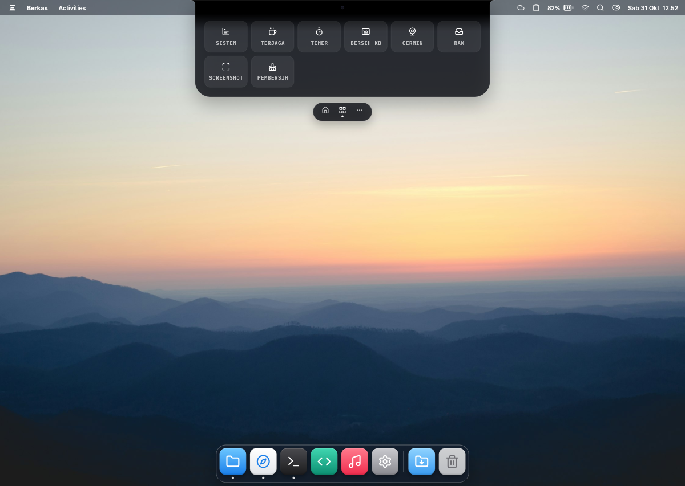 | 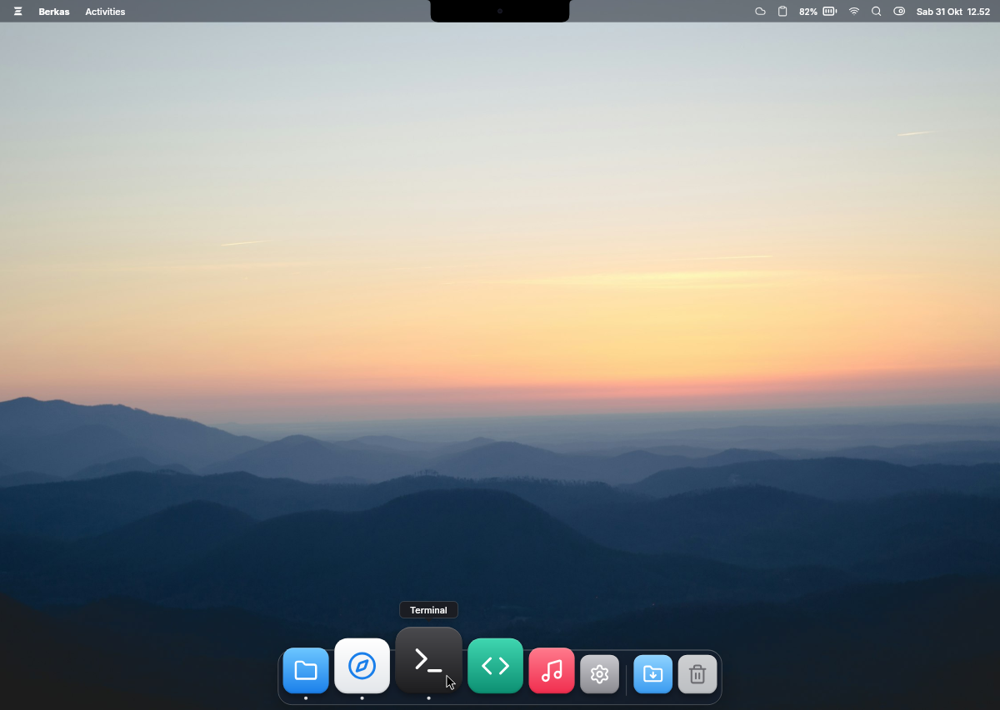 |

## Implementation

Screenshots from the extension running in a nested GNOME Shell.

| Hover: date, time, network, battery | Coding agent at work | Agent needs you |
|---|---|---|
| 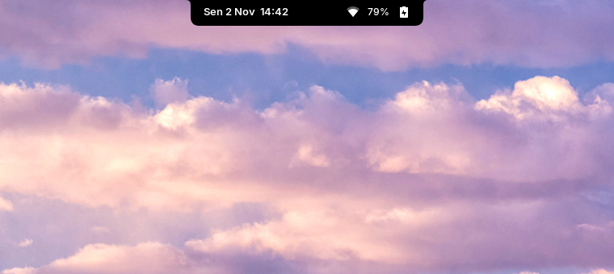 | 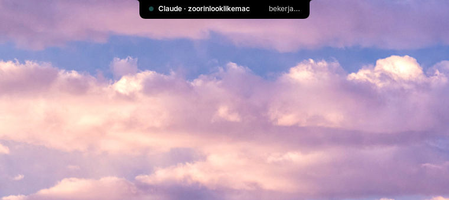 | 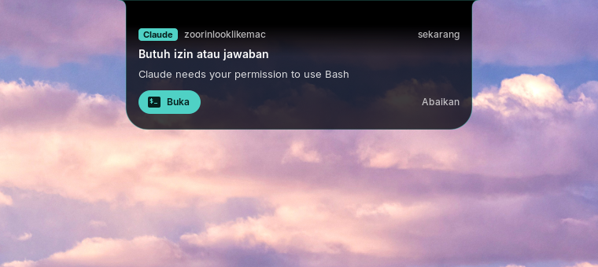 |

| Notification | Notification list | Search | Power menu |
|---|---|---|---|
| 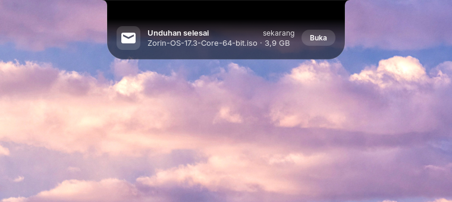 | 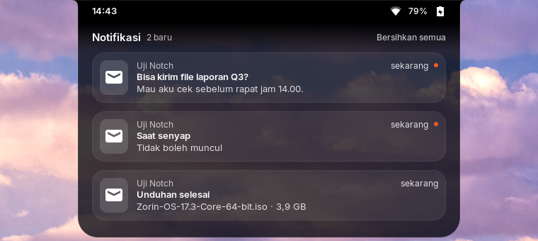 | 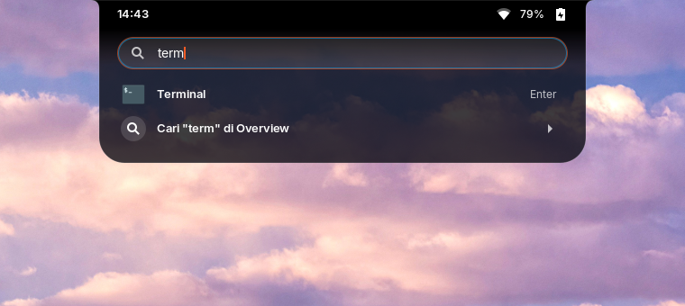 | 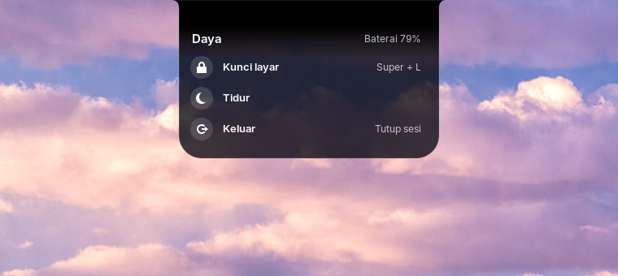 |

## Features

- **Notch** — a thin line when idle; hover shows date, time, network and battery; click opens
  the full panel. Esc or a click outside closes it. Springs instead of fixed-time animations.
- **Full panel** — Wi-Fi, Bluetooth, dark mode and do-not-disturb tiles (the circle toggles,
  the name opens details), volume and brightness sliders, the tray icons of running apps,
  Apps, search, notifications, settings, lock and power.
- **Wi-Fi** — networks as GNOME lists them; connecting uses GNOME's own flow and dialogs.
- **Notifications** — GNOME's banners pop out of the notch instead, with GNOME's own filters
  (do not disturb, per-app settings, urgency). An orange dot marks unread ones; the list
  keeps the newest, swipe right to dismiss.
- **Search** — app search inside the notch, ranked like GNOME's; Enter opens the first hit.
- **Power menu** — lock, suspend, log out, restart, power off through GNOME's SystemActions;
  log out, restart and power off show GNOME's confirmation dialog with its countdown and the
  list of apps with unsaved work.
- **Coding agents** — Claude Code and opencode report to the notch over D-Bus: a pulsing row
  while an agent works, a popup when it needs permission or input and when it finishes,
  with a button that focuses its window.
- **Dock** — zorin-taskbar turned into a floating, centered dock with a slim glass plate,
  icon magnification under the pointer and optional auto hide.
- **Preferences** — a GNOME preferences window (palette button in the full panel, or the
  Extensions app): dock auto hide, size, icon spacing, glass padding, distance from the
  bottom, zoom, glass opacity; notch standby line size, notification width, timings, coding
  agents, panel opacity, animations. Changes apply live.
- **Languages** — English (default) and Bahasa Indonesia, chosen in the preferences.
- **Themes** — dark, light (frosted glass) or following GNOME's dark mode, with an accent
  color (orange, blue, green, purple, pink) for the notch and the dock.
- **Permissions on the notch** — with the `zorin-notchd` daemon, a Claude Code permission
  prompt shows the tool and its command on the notch with Allow and Deny. No answer within a
  minute, or a command too long to read in full, and Claude asks in the terminal as usual.
- **Floating notch** — optionally a rounded pill a few pixels below the top edge.
- **Spotlight search** — the notch search (Search button, or press Super and start typing)
  with the selected result highlighted; ↑/↓ to move, Enter to open. With the `zorin-notchd`
  daemon (`scripts/install-daemon.sh`) it also finds files and folders by name and text inside
  documents, through GNOME's Tracker index; Ctrl+Enter opens the folder. Both can be switched
  off in the preferences.

## Requirements

- Zorin OS 18 (GNOME Shell 46) on Wayland
- `zorin-taskbar` (preinstalled on Zorin OS) for the dock
- `jq` and `gdbus` for the agent hooks
- From source: Rust (cargo) for the `zorin-notchd` daemon (`scripts/install-daemon.sh`)
- No sudo, no system files: everything lives in your home folder

## Install

### From a release (no build tools)

Download `zoorinlooklikemac-<version>-linux-x86_64.tar.gz` from
[Releases](https://github.com/soefyan45/zoorinlooklikemac/releases) (built by GitHub Actions on
Ubuntu 24.04, the base of Zorin OS 18), then:

```bash
tar xzf zoorinlooklikemac-*-linux-x86_64.tar.gz
cd zoorinlooklikemac-*-linux-x86_64
./install.sh                 # extension + zorin-notchd daemon (makes a backup first)
./install.sh --dock --agents # optional: also the dock preset and the agent hooks
./install.sh --remove        # take it out again
```

Then log out and back in.

### From source

```bash
git clone https://github.com/soefyan45/zoorinlooklikemac.git
cd zoorinlooklikemac
./scripts/install.sh              # copies the extension and enables it (makes a backup first)
./scripts/apply-dock.sh           # optional: zorin-taskbar as the dock
./scripts/install-agent-hooks.sh  # optional: Claude Code hooks + opencode plugin
```

Then log out and back in (on Wayland GNOME Shell loads new extensions at login).

### Fan boost (ASUS laptops, optional)

Some ASUS laptops (e.g. Zenbook 14) let the fan run only on the firmware's auto curve or at full
speed. `zoorin-fan-boost` is a small root service that turns it to full speed while the CPU is hot
and back to auto when it cools down (default: full from 75 °C, auto below 68 °C). It is off after
installing: turn it on
and set both temperatures in Preferences > Notch > Fan; they are written to
`/etc/zoorin-fan-boost/fan.conf` (owned by you) and the service picks them up within seconds.

```bash
sudo ./scripts/install-fan-boost.sh            # install and start
sudo ./scripts/install-fan-boost.sh --remove   # remove, fan back to auto
```

## Undo

```bash
./scripts/rollback.sh backups/<backup made before install>.dconf
./scripts/install-agent-hooks.sh --remove
rm -r ~/.local/share/gnome-shell/extensions/zoorinlooklikemac@soefyan45.github.io
```

`scripts/backup.sh` saves `/org/gnome/shell/` before every change, and `rollback.sh` restores
it (saving the current state first).

## Development

Test without logging out, in a nested GNOME Shell with its own settings database:

```bash
./scripts/nested-test.sh                     # 1440×900 window, power actions only log
SELFTEST=1 DOCK=1 ./scripts/nested-test.sh   # automated checks + screenshots in logs/shots
NOTIFY=1 TRACE=1 ./scripts/nested-test.sh    # a real notify-send, with state tracing
```

In a normal session, create `~/.cache/zorin-notch/trace` to turn on tracing in the journal:

```bash
journalctl --user -f | grep zorin-notch
```

Layout:

| Path | What |
|---|---|
| `extension/` | the GNOME Shell extension (`notch.js` state machine, `views.js` UI, `shape.js` Cairo drawing, `quicksettings.js`/`power.js`/`messages.js`/`tray.js`/`agents.js` bridges to GNOME, `dockzoom.js`) |
| `agents/` | Claude Code hook and opencode plugin |
| `dock/` | zorin-taskbar dock preset |
| `scripts/` | install, backup, rollback, nested test |
| `docs/` | product requirements and plan (Indonesian), design and implementation images |

## Notes

- Uses private fields of GNOME Shell 46 (quick settings items); each access is guarded, and a
  missing one only hides that control. Check again after a GNOME upgrade.
- The design shows Lucide icons; the extension uses GNOME's symbolic icons.

## License

[MIT](LICENSE)
